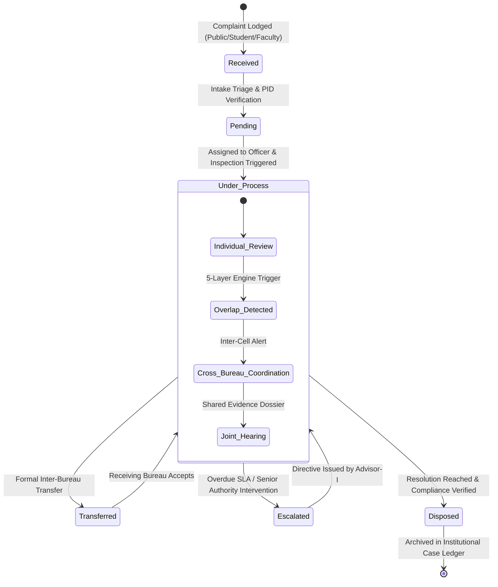

# 🏛️ AICTE CaseSync

### *AI-Powered Institutional Complaint Monitoring, Cross-Bureau Overlap Detection & Intelligent Routing Platform*

[](https://www.typescriptlang.org/)
[](https://react.dev/)
[](https://tailwindcss.com/)
[](https://expressjs.com/)
[](https://vitejs.dev/)

---

## 📖 Table of Contents
1. [The Problem Statement](#-the-problem-statement)
2. [Our Core Idea & Innovation](#-our-core-idea--innovation)
3. [Key Pillars & Architecture](#-key-pillars--architecture)
4. [5-Layer Overlap Detection Engine](#-5-layer-overlap-detection-engine)
5. [Role-Based Access Control (RBAC) & Bureau Scope](#-role-based-access-control-rbac--bureau-scope)
6. [Operational Workflow & State Machine](#-operational-workflow--state-machine)
7. [System Screenshots & Modules](#-system-screenshots--modules)
8. [Technology Stack](#-technology-stack)
9. [Getting Started](#-getting-started)
10. [Expected Impact & Benefits](#-expected-impact--benefits)

---

## 🚨 The Problem Statement

The **All India Council for Technical Education (AICTE)** oversees more than 10,000 technical and professional institutions across India. Over the course of an academic year, hundreds of grievances, inspection findings, regulatory non-compliance notices, and student/faculty complaints are filed across multiple independent bureaus and cells:

- **Regulation Bureau (RB)**: Deals with affiliation norms, faculty qualification violations, building norms, and statutory non-compliance.
- **Public Grievance Redressal Cell (PGRC)**: Handles student grievances regarding unreturned certificates, capitation fees, arbitrary fee hikes, and examination disputes.
- **Approval Bureau (AB)**: Manages intake approvals, course sanctioning, and institutional expansion sanctions.
- **Faculty Grievance Cell (FGC)**: Handles unpaid salary arrears, illegal terminations, and service condition violations.
- **Regional Offices (SWRO, NWRO, SRO, ERO, etc.)**: Conduct physical inspections, surprise audits, and regional verification.

### Current Deficiencies:
1. **Bureau Silos & Fragmented Dossiers**: A single technical college may simultaneously face an inquiry in the Regulation Bureau for faculty shortage, while students are protesting arbitrary fees in PGRC, and the Approval Bureau is processing an application for increasing student seats. Each department operates with separate records without visibility into parallel proceedings.
2. **Duplication of Investigations**: Multiple inspection teams or showcause notices are issued to the same institution for issues stemming from the same root cause.
3. **Identity Ambiguity**: Institutions are frequently cited under informal names (*"Apex Engg Institute"*, *"Apex Institute of Technology Bangalore"*, *"Apex Tech Campus"*) leading to separate, unlinked files when AICTE Permanent IDs (PIDs) are omitted or misentered.
4. **SLA Deadlines & Accountability Gaps**: Lack of an automated statutory deadline monitor leads to cases stalling or being forgotten during inter-departmental transfers.

---

## 💡 Our Core Idea & Innovation

### *"One Institution. One Coordinated View."*

**AICTE CaseSync** introduces a unified, institution-centric intelligence and coordination platform that bridges all AICTE bureaus. Instead of treating complaints as isolated tickets, CaseSync organizes every case around the **AICTE Permanent ID (PID)** and provides a 360-degree real-time institutional profile.

```
                           ┌────────────────────────────────────────┐
                           │          AICTE CaseSync Engine         │
                           │     Unified Cross-Bureau Platform      │
                           └───────────────────┬────────────────────┘
                                               │
               ┌───────────────────────────────┼───────────────────────────────┐
               ▼                               ▼                               ▼
    ┌──────────────────────┐        ┌──────────────────────┐        ┌──────────────────────┐
    │  Regulation Bureau   │        │     PGRC & FGC       │        │   Regional Offices   │
    │  Regulatory Norms    │        │ Student & Faculty    │        │ Physical Inspections │
    └──────────┬───────────┘        └──────────┬───────────┘        └──────────┬───────────┘
               │                               │                               │
               └───────────────────────┐       │       ┌───────────────────────┘
                                       ▼       ▼       ▼
                           ┌────────────────────────────────────────┐
                           │  5-Layer Overlap & Relationship Engine │
                           │   (Deterministic + Keyword + Temporal) │
                           └───────────────────┬────────────────────┘
                                               │
                                               ▼
                           ┌────────────────────────────────────────┐
                           │    Institutions Knowledge Graph        │
                           │   Single Coordinated Case Dossier      │
                           └────────────────────────────────────────┘
```

### Key Breakthroughs:
- **Institution-Centric Graph**: Links all cases, inspection reports, past violations, and current approvals under a single verifiable institutional record.
- **Automated Overlap Detection**: A transparent, 5-layer pipeline that immediately detects related complaints across different bureaus, even when institution names are misspelled or informal.
- **Human-in-the-Loop Validation**: Automated signals highlight potential duplications, but human officers verify and link cases with explicit justifications.
- **Formal Inter-Bureau Coordination**: Built-in joint hearing scheduling, cross-bureau task requests, and formal case transfer handoffs with SLA preservation.
- **Full Traceability & Audit Trail**: Every status change, officer reassignment, transfer, and escalation is timestamped and immutably logged.

---

## 🔬 5-Layer Overlap Detection Engine

To prevent false-positives while guaranteeing high recall, CaseSync uses a deterministic, transparent 5-layer matching pipeline rather than a black-box model:

| Layer | Name | Mechanism | Threshold / Rule | Action |
| :---: | :--- | :--- | :--- | :--- |
| **Layer 1** | **Exact AICTE Permanent ID Match** | Direct deterministic match on `aicte_permanent_id` (e.g. `1-482910421`). | Exact string equality (case-insensitive, trimmed). | **Highest Precedence**. Immediately establishes that complaints belong to the exact same institution. |
| **Layer 2** | **Normalized Name & Aliases** | Fuzzy string matching (Levenshtein distance, Jaro-Winkler, token sorting) on college names, state, and city. | Token overlap score $\ge 0.85$. | Flags potential match and prompts officer to verify if institutional identity is uncertain. |
| **Layer 3** | **Category, Norm & Keyword Signal** | Compares complaint categories, regulatory norm codes (e.g., Norm 4.2 faculty ratio, Norm 7.1 fee structure), and infraction keywords. | Keyword intersection score $\ge 0.60$. | Identifies related sub-issues within the same institution. |
| **Layer 4** | **Temporal & Bureau Window Overlap** | Checks if multiple active cases exist at the same institution within a rolling active window ($\le 90$ days). | Active case status across $\ge 2$ different bureaus. | Triggers automatic **"Cross-Bureau Coordination Alert"** to prevent conflicting rulings. |
| **Layer 5** | **Human Officer Review & Audit** | Human verification screen allowing designated officers to confirm, merge, dismiss, or flag links. | Explicit justification logged in immutable audit trail. | Converts candidate overlap into **"Confirmed Related Cases"** or **"Not Related — Reviewed"**. |

---

## 🛡️ Role-Based Access Control (RBAC) & Bureau Scope

CaseSync implements server-enforced RBAC ensuring that sensitive remarks and departmental operations respect institutional hierarchy:

```text
┌───────────────────────────────────────┬──────────────────────────┬────────────────────────────────────────────────────────┐
│ Role                                  │ Scoped Bureau            │ Key Permissions & Visibility                           │
├───────────────────────────────────────┼──────────────────────────┼────────────────────────────────────────────────────────┤
│ 👑 Administrator                      │ All Bureaus & Cells      │ Full administrative control across all 12 institutions,│
│                                       │                          │ all cases, SLA settings, and audit logs.               │
│ ⚖️ Regulation Bureau Officer (RB)     │ Regulation Bureau (RB)   │ Scoped to RB regulatory non-compliance inquiries,      │
│                                       │                          │ norm verification, and cross-bureau coordination.      │
│ 📋 PGRC Officer                       │ PGRC                     │ Scoped to student grievance redressal, certificate     │
│                                       │                          │ retention, fee refunds, and student disputes.          │
│ 📍 Regional Officer                   │ Southern Regional Office │ Scoped to SRO regional inspections, campus visits,     │
│                                       │ (SRO)                    │ and institution registry.                              │
│ 🏛️ Senior Management (Advisor-I)      │ Executive Oversight      │ Oversight across overdue cases, 2-tier escalations,    │
│                                       │                          │ inter-bureau disputes, and analytical reports.         │
│ 📝 Submitter                          │ Public / Institutional   │ Lodging complaints and tracking status; restricted     │
│                                       │                          │ from viewing internal bureau remarks.                  │
└───────────────────────────────────────┴──────────────────────────┴────────────────────────────────────────────────────────┘
```

---

## 🔄 Operational Workflow & State Machine



### Core Workflows:
1. **Intake & Triage**: When a complaint is lodged, Layer 1 immediately looks up the institution by PID. If unknown, Layer 2 suggests candidate institutions.
2. **Overlap Review**: If overlapping cases exist in another bureau, both bureau officers receive high-priority alerts with direct links to the sibling case dossiers.
3. **Bureau Coordination**: Officers can request joint inspection teams, share evidence documents, or hold a combined hearing.
4. **Handoff & Transfer**: If an investigation reveals that the core issue belongs to another bureau (e.g. a student fee complaint uncovers systemic fraudulent approvals), a formal Transfer with reason and notes is initiated. The receiving bureau must accept or return with remarks.
5. **Two-Tier Escalation**: If a case exceeds its configured statutory SLA (e.g. 15 or 30 days) or requires policy intervention, it can be escalated to Level 1 (Bureau Head) or Level 2 (Advisor-I / Competent Authority).

---

## 💻 System Modules

1. **Executive Dashboard**: Real-time KPIs for Total Complaints, Overdue Cases, Under Process, Transferred, Overlaps, and Disposal Rate with interactive date and bureau filters.
2. **Consolidated Case Ledger**: Comprehensive search and multi-facet filtering across AICTE PID, Case ID, Category, Region, Bureau, Status, Priority, and Receipt/Activity dates.
3. **Institution Registry**: Institutional dossiers tracking permanent AICTE approval status, address, active courses, past violations, and all historical cases.
4. **Overlap Detection Queue**: Split-card comparative view displaying side-by-side complaint details, signal alignment scores, shared norm tags, and one-click relationship confirmations.
5. **Bureau Coordination Center**: Multi-bureau collaborative channel for joint hearings, shared actions, and synchronized milestone tracking.
6. **Transfers & Escalations Hub**: Formal workflow tracker ensuring no transferred case is dropped or lost between departments.
7. **Operational Alerts & Notifications**: Real-time notification center tracking impending SLA expirations, pending transfer acceptances, and coordination requests.
8. **Reports & Analytics**: Visual charts breaking down complaints by Category, Bureau volume, Regional density, and Average Resolution Time with filtered CSV export.
9. **Tamper-Evident Audit Trail**: Complete immutable event log capturing timestamp, acting officer, role, action type, and before/after state diffs.
10. **System Governance & SLA Configuration**: Granular control over statutory disposal days, warning thresholds, similarity limits, and exact PID priority enforcement.

---

## 🛠️ Technology Stack

| Component | Technology | Rationale |
| :--- | :--- | :--- |
| **Frontend Framework** | **React 19** + **TypeScript** | High-performance reactive UI with modern hooks and complete type safety. |
| **Styling & Design System** | **Tailwind CSS v4** + Custom Neumorphic System | Custom, accessible, contrast-compliant design system with seamless Dark/Light modes. |
| **Animations** | **Motion (Framer Motion)** | Fluid 200ms transitions, sliding tabs, and reduced-motion accessibility. |
| **Icons** | **Lucide React** | Consistent, crisp administrative and institutional iconography. |
| **Backend Server** | **Node.js** + **Express 4.21** | Lightweight, high-throughput REST API server with custom security middleware. |
| **Build Tool & Bundler** | **Vite 8.3** (Middleware Mode) | Instant HMR in development and compact, tree-shaken static production bundles. |
| **Database ORM Schema** | **Prisma** (PostgreSQL-compatible) | Production-ready relational schema in `backend/prisma/schema.prisma`. |
| **Local State Store** | JSON-based persistent database (`data-store.json`) | Zero-friction local setup that persists changes between server restarts without requiring a separate DB installation for evaluation. |

---

## 🚀 Getting Started

For full detailed setup instructions, network IP configuration, and production packaging, see **[HOW_TO_RUN.md](file:///c:/Users/murar/OneDrive/Documents/sih/AICTE-CASESYNC-/HOW_TO_RUN.md)**.

### Quick Start:
```bash
# 1. Install dependencies
npm install

# 2. Start full-stack server (Frontend + Backend on Port 3000)
npm run dev

# 3. Open in browser
# Local:   http://localhost:3000
# Network: http://<YOUR-IP>:3000
```

---

## 📈 Expected Impact & Benefits

- **70% Reduction in Duplicate Proceedings**: Eliminates parallel, redundant showcause notices and inspections for the same underlying institutional infraction.
- **Zero-Loss Case Transfers**: Eliminates cases slipping through administrative cracks during bureau handoffs.
- **Statutory SLA Adherence**: Automated 4-day "Due Soon" and "Overdue" alerts keep officers accountable before deadlines lapse.
- **Complete Institutional Memory**: AICTE officers possess the full historical compliance profile of an institution when assessing new complaints or approving seat expansion requests.
- **Defensible Decisions**: Full cryptographic and chronological audit trails defend AICTE against litigation and RTI queries with verifiable decision records.

---

## 📜 License
This project is licensed under the Apache 2.0 License. Developed for technical education governance and institutional grievance synchronization.
